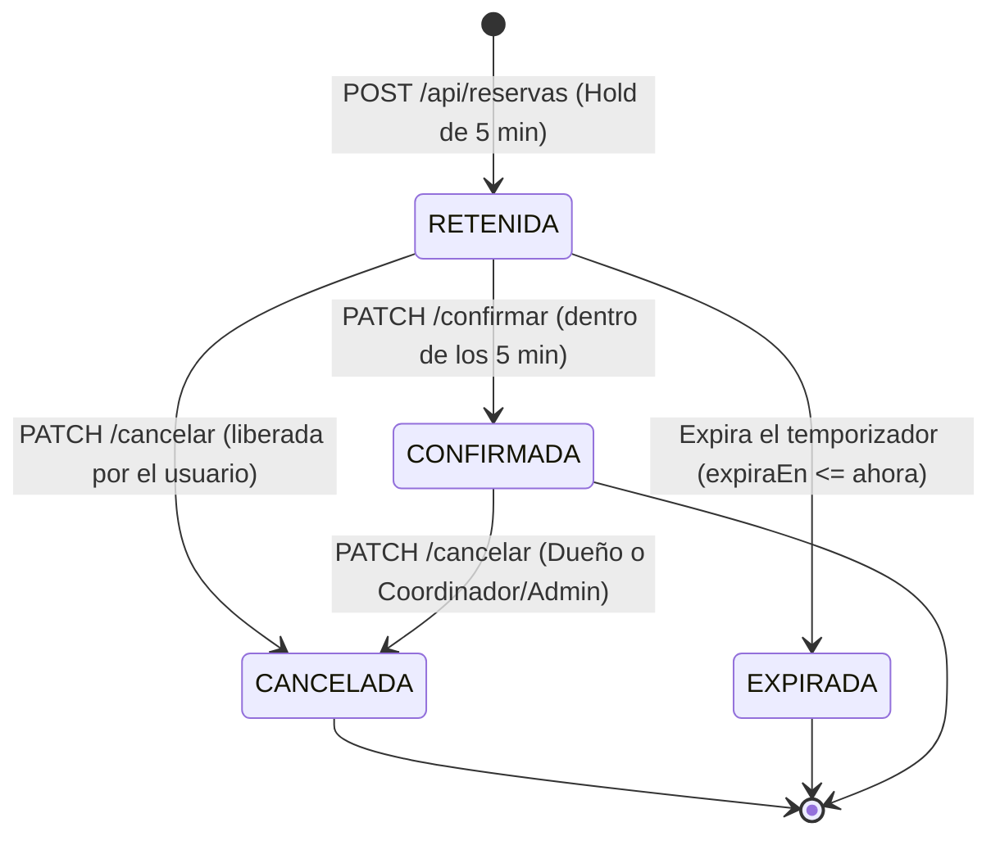

# Documentación y Evidencia de Implementación — HU004 (Sistema de Reservas)

**Proyecto:** AMGO — Sistema de Gestión de Laboratorios  
**Institución:** Universidad Católica Luis Amigó — Facultad de Ingeniería  
**Historia de Usuario:** HU004 — Panel de disponibilidad semanal y reserva de recursos  
**Directriz:** ADENDA 2 — Prototipo visual y modelo sin costo institucional  
**Rama:** `feat/hu4-reservas`

---

## 1. Resumen Ejecutivo y Decisiones Clave (ADENDA 2)

1. **Modelo Sin Costo:** El laboratorio AMGO es un recurso académico institucional de la universidad y **no realiza cobros** por su uso. Se eliminaron todas las referencias a tarifas por hora, subtotales, descuentos por rol y módulos de costo. El CA3 se cumple mediante el detalle exhaustivo de la solicitud y la mención explícita: **"Costo: Sin costo (uso institucional)"**.
2. **Entidad Recurso (reemplaza Espacio):** Modelo Prisma `Recurso` (`recursos`, `recurso_id`), con endpoints `GET /api/recursos`. Se configuraron como placeholders en el seed: `"Computador 3 - GPU"`, `"Laboratorio Redes 2"`, `"Sala IA - Workstation 1"`.
3. **Bloques Fijos de 2 Horas:** La operación se rige por bloques configurados en `src/lib/config.ts`:
   - Bloque 1: `08:00 - 10:00`
   - Bloque 2: `10:00 - 12:00`
   - Bloque 3: `14:00 - 16:00` (respetando el hueco de almuerzo 12:00 - 14:00).
   - Zona horaria: **Bogotá (`America/Bogota`, UTC-5)**.
   - Días hábiles: **Lunes a viernes**.
   - Anticipación máxima: **30 días**.
   - Tiempo de retención: **5 minutos** (`HOLD_MINUTOS = 5`).
4. **Ciclo de Estados y Concurrencia:**
   - Estados: `RETENIDA` (retención temporal transaccional) $\rightarrow$ `CONFIRMADA`, `CANCELADA`, `EXPIRADA`.
   - Máximo una retención activa por usuario.
   - Prevención de condiciones de carrera mediante transacciones atómicas y `updateMany` con verificación de `expiraEn`.
5. **Casi Tiempo Real (CA5):** Retención transaccional en el servidor combinada con sondeo (polling) cada 10 segundos en el cliente mientras la pestaña está visible (`visibilitychange`). Deselección automática si un bloque cambia de estado.

---

## 2. Matriz de Evidencia: Criterios de Aceptación (CA) y Tareas

| Criterio de Aceptación | Tarea Asociada | Archivos Involucrados | Commits Clave | Pruebas Unitarias / Integración |
| :--- | :--- | :--- | :--- | :--- |
| **CA1: Consulta de disponibilidad semanal** | Tarea 1 & 2: Configuración de bloques y endpoint de disponibilidad | `src/lib/config.ts`<br>`src/app/api/recursos/route.ts`<br>`src/app/api/reservas/disponibilidad/route.ts` | `2f9a75e`<br>`b2d05ca` | `tests/config-bloques.test.ts`<br>`tests/recursos-disponibilidad.test.ts` |
| **CA2: Selección y validación de horarios** | Tarea 1 & 4: Reglas de validación Bogotá y grilla interactiva | `src/lib/config.ts`<br>`src/app/dashboard/reservas/page.tsx` | `2f9a75e`<br>`7c26ba8` | `tests/config-bloques.test.ts` (bloque válido, hueco 12-14, 07:00, 16:00, fin de semana, minutos != 0, pasado, límite 30d, medianoche Bogotá vs UTC) |
| **CA3: Solicitud y detalle sin costo** | Tarea 3 & 5: Endpoint de retención temporal y vista de confirmación | `src/app/api/reservas/route.ts`<br>`src/app/dashboard/reservas/confirmar/[id]/page.tsx` | `faee0bb`<br>`a4b3cea` | `tests/reservas-flujo.test.ts` (tipo inválido, expiración, detalle institucional) |
| **CA4: Confirmación y prevención de conflictos** | Tarea 3: Transacciones atómicas, confirmación y cancelación | `src/app/api/reservas/[id]/confirmar/route.ts`<br>`src/app/api/reservas/[id]/cancelar/route.ts`<br>`src/app/api/reservas/[id]/route.ts` | `faee0bb` | `tests/reservas-flujo.test.ts` (concurrencia 10 POST simultáneos $\rightarrow$ 1x 201 y 9x 409, 410 expirado, 404 no dueño) |
| **CA5: Actualización en casi tiempo real** | Tarea 4: Polling cada 10s con AbortController y visibilidad | `src/app/dashboard/reservas/page.tsx` | `7c26ba8` | Verificado en cliente con revalidación y deselección automática ante bloque ocupado |
| **Gestión: Mis reservas** | Tarea 6: Historial, filtros y cancelación | `src/app/api/reservas/route.ts`<br>`src/app/dashboard/reservas/mis-reservas/page.tsx` | `faee0bb`<br>`a4b3cea` | `tests/reservas-flujo.test.ts` (alcance `mias` vs `todas` por rol, cancelación por dueño o coordinador) |

---

## 3. Ciclo de Vida de los Estados de una Reserva



### Reglas de Negocio Asociadas a los Estados:
- **`RETENIDA`:** Estado temporal creado al pulsar "Enviar solicitud". Otorga exclusividad sobre el bloque durante `HOLD_MINUTOS = 5` o hasta el inicio del bloque (lo que ocurra primero). Cada usuario solo puede tener una retención activa simultáneamente.
- **`CONFIRMADA`:** El usuario pulsa explícitamente "Confirmar reserva" en `/dashboard/reservas/confirmar/[id]`. La transición es atómica mediante `updateMany`.
- **`EXPIRADA`:** Si expira el plazo sin confirmación, la retención es liberada de forma perezosa/automática por el servidor, quedando disponible nuevamente para cualquier usuario.
- **`CANCELADA`:** El dueño puede cancelar su reserva si está en estado `RETENIDA` o `CONFIRMADA`. Coordinadores y Administradores pueden cancelar cualquier reserva `CONFIRMADA`.

---

## 4. Resolución del CA3: Modelo Sin Costo Institucional

Siguiendo la **ADENDA 2**, la Universidad Católica Luis Amigó ofrece el laboratorio sin cobro monetario para docencia, prácticas e investigación.
- **Sin tarifas:** Se eliminaron los campos `tarifaHora`, `subtotal`, `descuento`, `total`, `costo.ts` y pruebas de cálculo de COP.
- **Tipo de uso obligatorio:** El modelo `Reserva` incluye `tipo: TipoUso` (`CLASE`, `PRACTICA`, `INVESTIGACION`).
- **Resolución en interfaz:** En `/dashboard/reservas/confirmar/[id]` se presentan todos los metadatos requeridos (recurso, solicitante, rol institucional, fecha, horario de 2 horas, tipo de uso) y se incluye una línea explícita:
  > **Costo: Sin costo (uso institucional)**

---

## 5. Implementación del "Casi Tiempo Real" (CA5)

El requerimiento de sincronización en tiempo real se implementó mediante una arquitectura de dos capas:
1. **Garantía Transaccional en Base de Datos:** En el backend, toda solicitud `POST /api/reservas` y confirmación `PATCH /confirmar` opera bajo transacciones atómicas con verificación de solapamiento (`inicio < fin && fin > inicio`) y bloqueo de retención, evitando dobles reservas incluso bajo peticiones concurrentes idénticas en el mismo milisegundo.
2. **Sondeo Inteligente en Frontend (10 s):** En `/dashboard/reservas`, un efecto con `setInterval(..., 10000)` consulta periódicamente `/api/reservas/disponibilidad`. Para optimizar recursos del cliente y del servidor:
   - Se utiliza `AbortController` para cancelar solicitudes pendientes.
   - Se escucha el evento `document.addEventListener("visibilitychange")`: si el usuario minimiza la pestaña o cambia de ventana, el sondeo se suspende; al regresar a la pestaña, se reactiva de inmediato.
   - Si el bloque que el usuario tenía seleccionado es tomado por otro solicitante, el sistema deselecciona el horario automáticamente y muestra una alerta (`role="alert"`).

---

## 6. Diferencias Deliberadas Respecto al Prototipo

En estricto apego a las instrucciones de la ADENDA 2, se implementaron las siguientes desviaciones deliberadas respecto a la imagen del prototipo de HU004:

1. **Navegación entre semanas y número de día en columnas:**
   - *Prototipo:* Mostraba solo nombres de días fijos ("Lunes", "Martes", etc.) sin fecha concreta ni controles de cambio de semana.
   - *Implementación:* Añade controles de navegación con flechas ($\leftarrow$ $\rightarrow$) restringidos entre la semana actual y un máximo de 30 días a futuro. Las columnas indican el día exacto (p. ej. "Lun 12", "Mar 13", "Mié 14"), otorgando certidumbre de calendario al usuario.
2. **Leyenda alineada con los colores reales de la grilla:**
   - *Prototipo:* Presentaba discrepancias leves entre los tonos de la leyenda y las celdas activas.
   - *Implementación:* La leyenda comparte las clases y estilos exactos de las celdas:
     - **Disponible:** Azul claro (`bg-blue-50 text-blue-700 border-blue-200`)
     - **Ocupado:** Rojo suave (`bg-red-50 text-red-700 border-red-200`)
     - **Seleccionado:** Naranja suave con borde azul (`bg-orange-100 text-orange-900 border-2 border-blue-600`)
     - **En proceso:** Rojo más claro con borde punteado (`bg-red-50/70 text-red-600 border border-dashed border-red-300`)
     - **Pasado:** Gris deshabilitado (`bg-gray-100 text-gray-400 border-gray-200`)
3. **Estados con texto explícito y accesibilidad:**
   - *Prototipo:* Dependía primariamente de color en las celdas.
   - *Implementación:* Cada celda contiene texto legible explícito ("Disponible", "Ocupado", "Seleccionado", "En proceso", "Pasado"), atributos `aria-pressed`, soporte de foco visible por teclado y roles de alerta (`role="alert"`).
4. **Botón "Cerrar sesión" en la tarjeta de usuario:**
   - *Prototipo:* El prototipo visual no contemplaba el botón de logout en el panel lateral.
   - *Implementación:* Se incluyó el botón funcional "Cerrar sesión" dentro del componente de tarjeta de usuario en la parte inferior del sidebar, preservando la funcionalidad de autenticación establecida en el Paso 0.

---

## 7. Registro de Commits de la Rama `feat/hu4-reservas`

```text
a4b3cea feat: vista de confirmación con cuenta regresiva y página de mis reservas
7c26ba8 feat: panel de disponibilidad semanal con grilla interactiva y polling
cb7fbb8 feat: layout del dashboard con sidebar, tarjeta de usuario y navegación responsive
faee0bb feat: flujo de retención, confirmación y cancelación de reservas
b2d05ca feat: endpoints de recursos y disponibilidad semanal
2f9a75e feat: define configuración de bloques y validaciones de tiempo
e92ea59 chore: configura Prisma, base de datos SQLite y seed inicial
ea61756 merge: integra origin/master y conserva .gitignore completo
```

---

## 8. Verificación de Pruebas Automatizadas

Todas las suites de prueba ejecutan de forma exitosa (`89 passed, 89 total`):
- `tests/config-bloques.test.ts`: Pruebas de reglas de tiempo de Bogotá y validación de bloques.
- `tests/recursos-disponibilidad.test.ts`: Pruebas de endpoints `/api/recursos` y disponibilidad semanal.
- `tests/reservas-flujo.test.ts`: Pruebas de integración, retención, 10 solicitudes concurrentes (1x 201 y 9x 409), expiración forzada y permisos por rol.
- `tests/auth.test.ts`, `tests/session.test.ts`, `tests/rate-limit.test.ts`: Pruebas de seguridad y autenticación.
